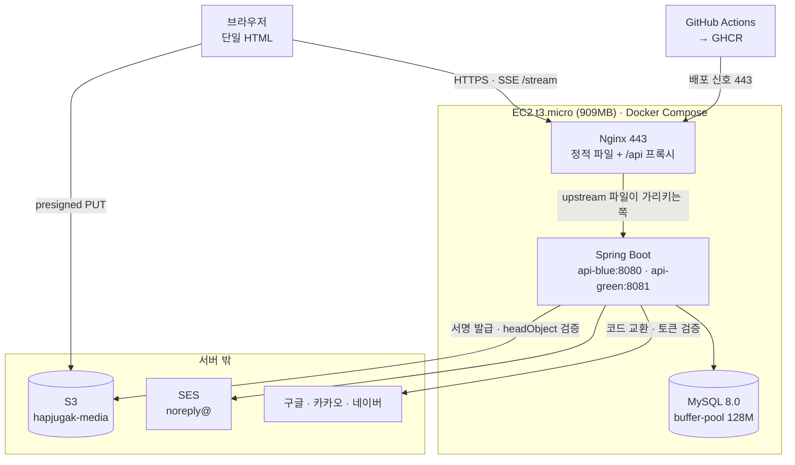
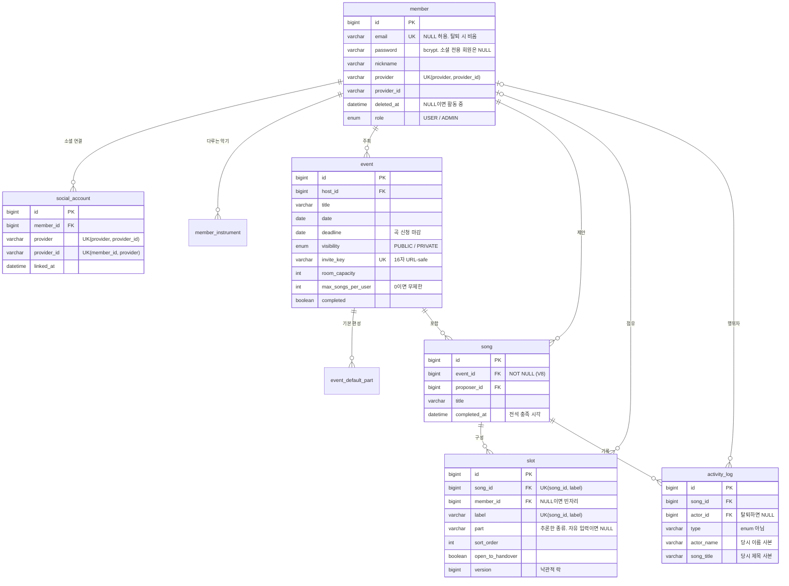

# 합주각 (Hapjugak)

밴드 합주팟을 짤 때 파트별로 멤버를 편하게 모으려고 만든 서비스입니다. 처음에 Firebase로 배포해서 두 달 반 정도 실제 운영해 봤는데, 운영하면서 부딪힌 여러 한계점들을 근거로 백엔드를 처음부터 직접 짜서 새로 배포했습니다.

서비스 주소는 https://hapjugak.com 입니다.

---

## 개발자

장준호 · 백엔드 개발자 지원 · [github.com/SaAe1101](https://github.com/SaAe1101)

---

## 프로젝트 개요

|||
|-|-|
|기간|2026.08 ~ 운영 중 (Firebase 2.5개월 운영 후 10월 백엔드 재구축)|
|인원|1명 (1인 개발)|
|역할|기획, 프론트엔드, 백엔드, DB 설계, 인프라, 배포 전 과정|
|이관 규모|회원 26명, 곡 80개, 파트 자리 398개, 활동 로그 270건 (2026.10 이관 시점 기준)|
|운영 환경|AWS EC2 1대 (t3.micro, ap-southeast-2), 월 약 $10|
|코드 규모|백엔드 6,755줄, 테스트 2,392줄(109개), 프론트 단일 HTML 6,020줄|

---

## 왜 만들었을까요?

합주각은 여러 명이 모인 단톡방이나 풀에서 매번 새로운 조합으로 '합주팟'을 꾸리는 모임을 위한 서비스입니다. 고정 멤버끼리 구르는 밴드와 달리, 이런 모임은 매번 백지상태에서 누가 어느 곡에 어떤 파트로 들어갈지를 새로 정해야 하거든요. 사람이 많아질수록 이 조율 과정이 너무 피곤해져서 직접 만들게 되었습니다.

### 조율도 어렵고, 성사도 안되서

합주 날짜를 잡고 단톡방에 "할 곡 추천받아요" 하고 올리면 곡 이름들이 우르르 올라오긴 합니다. 
하지만 다들 자기가 제일 치고 싶은 곡에만 슬쩍 이름을 올리고 끝나요. 누가 어느 곡에 들어갔는지 전체 파악도 잘 안 됩니다.

```
A곡 — 보컬 1
B곡 — 드럼 1
C곡 — 기타 1, 베이스 1
D곡 — 보컬 1
 ⋮     스무 곡에 한두 명씩 흩어짐
        → 한 곡도 성사되지 않음
```

결국 사람은 충분한데 단 한 곡도 성사되지 않는 대참사가 벌어집니다.

### 왜 의견 조율이 안되고 곡 성립도 안되는가?

가장 큰 이유는 '지금 누가 어느 곡에 어떤 파트로 들어갔는지 한눈에 볼 방법이 없기 때문'이라고 봤습니다.

예를 들어 C곡에 기타 한 명만 더 오면 합주가 성사되는 상황이라고 쳐볼게요. 기타 치는 분 입장에선 C곡이 1지망이 아니더라도, 한 자리만 채우면 합주를 할 수 있으니 들어갈 마음이 생길 겁니다. 하지만 그 정보가 어디에도 없어요. 단톡방 수백 개 메시지를 거슬러 올라가며 직접 집계해야 알 수 있는데 아무도 그걸 안 하죠.
그래서 다들 자기 1픽만 외치다가 모든 곡이 미완성으로 남게 됩니다.

### 실제로 벌어진 일

비싼 합주실은 이미 예약해 놨는데 곡은 하나도 안 정해진 채로 현장에 모인 적도 있습니다. 그제야 "우리 오늘 뭐 치지?", "이건 누가 칠래?" 하면서 대관 시간을 날려먹었죠.

일정 공지도 완전 수동 노가다였습니다. 날짜, 시간, 장소, 참가비를 단톡방에 올리고 내용이 바뀌면 또 공지하고, 못 본 사람 챙겨주는 일의 반복이었어요.

### 그래서 만든 것

단톡방에 파편화되어 흩어지던 정보들을 모조리 서비스의 '상태'로 들고 있게 만들었습니다. 곡 추천부터 자리 선점, 성립 여부, 일정 공지까지 전부 한 화면에서 보고 누를 수 있게 바꿨습니다.

핵심 뼈대는 4가지입니다.

|기둥|겪은 문제|기능|
|-|-|-|
|곡 추천을 한곳에 모읍니다|추천곡이 메시지 사이에 묻혀 뭐가 나왔는지도 모름|일정마다 곡 목록이 쌓입니다|
|자리를 눈에 보이게 만듭니다|누가 어느 곡 어느 파트인지 집계가 안 됨|곡마다 파트 자리를 만들어 점유자와 빈자리를 함께 보여줍니다|
|자리를 선점할 수 있게 합니다|같은 파트에 두 명이 신청하고, 이탈 메시지는 묻힘|한 자리에 한 명. 찬 자리는 버튼이 막히고, 못 가게 되면 양도로 넘깁니다|
|성립 여부를 알려줍니다|수요가 흩어져 한 곡도 성사되지 않음|다 차면 성립 표시가 붙고, 비어 있는 파트로 곡을 거를 수 있습니다|

여기에 편의 기능 3가지를 더 붙였습니다.

|겪은 문제|기능|
|-|-|
|합주 직전에 곡이 추가됨|일정마다 곡 신청 마감일이 있고, 지나면 서버가 거부합니다|
|스케줄 안내가 매번 수동|날짜, 합주실, 시간, 참가비, 정원을 일정에 담고, 바뀌면 접속 중인 모든 화면이 즉시 갱신됩니다|
|지난달에 뭘 했는지 아무도 기억 못 함|끝난 합주는 추억 저장소로 넘어가 곡과 참여자가 남습니다|

뒤에 나올 기술 스택들은 모두 이 기능들을 매끄럽게 굴리기 위해 선택한 것들입니다. 자리를 명확히 보여주려고 `slot`을 별도 테이블로 뺐고, 선점 경쟁을 막으려고 낙관적 락을 걸었으며, 빈자리 검색을 위해 `hasOpenPart` 동적 쿼리를 짰고, 실시간 동기화를 위해 SSE 방식을 붙였습니다.

---

## 기술 스택

|구분|기술|
|-|-|
|깊게 다룬 것|Java 17, Spring Boot 4.1.2, Spring Data JPA (Hibernate 7), MySQL 8.0, QueryDSL 7.4, Spring Security + JWT, JUnit 5|
|직접 구성해 운영 중인 것|Docker Compose, Nginx, AWS EC2, AWS S3, AWS SES, GitHub Actions, Flyway, SSE, Let's Encrypt|
|써본 것|Firebase (Auth, Firestore), Netlify|

### 선택 이유

**QueryDSL.** 곡 검색에 조건 세 개(키워드, 비어 있는 파트, 일정)가 들어가고 뷰어별 공개 범위 조건까지 붙습니다. 기본 JPA 메서드로는 조합마다 코드를 짜야 하지만, QueryDSL은 조건이 `null`이면 깔끔하게 무시해 줘서 코드 한 벌로 끝낼 수 있었습니다. 조건 없는 단순 CRUD에는 기본 메서드를 그대로 씁니다. (기존 `com.querydsl` 라이브러리는 유지보수가 멈춰서 Hibernate 7 버전과 맞지 않아 OpenFeign 포크 버전을 썼습니다.)

**낙관적 락.** 우리 서비스는 '자리' 단위로 세밀하게 쪼개져 있어서 실제로 충돌할 확률이 매우 낮습니다. 비관적 락을 쓰면 충돌이 별로 없는 상황에서도 락 대기 비용을 상시로 치러야 합니다. 수강신청처럼 단일 재고를 다투는 곳에선 재시도가 폭증하겠지만, 여기선 무거운 락을 쓸 필요가 없다고 판단했습니다.

**SSE.** 서버에서 화면 쪽으로 일방적인 알림만 쏴주면 되는 구조입니다. WebSocket은 양방향 연결 관리도 귀찮고 프록시 설정도 까다로운데, SSE는 이 서비스에 딱 맞는 가벼운 통신 방식이었습니다.

**presigned URL.** 업로드 파일이 서버를 거치지 않습니다. EC2 램이 1GB라서 동시 업로드가 몰리면 서버가 바로 뻗어버릴 수 있습니다. 서명 방식은 서버가 서명된 URL 문자열 하나만 던져주면 끝납니다. 서명할 때 파일 크기 제한을 못 거는 문제는 업로드 직후 서버가 다시 검증하는 단계를 둬서 해결했습니다.

**EC2 한 대에 앱과 DB.** RDS를 따로 빼면 한 달에 $32가 나가는데, EC2 한 대에 몰아넣으면 $10면 됩니다. 대신 909MB 메모리에 둘 다 구겨 넣어야 해서 `-Xmx400m`, `innodb-buffer-pool-size=128M`로 세팅하고 스왑 메모리를 2GB 잡아 간신히 숨통을 틔워뒀습니다. 나중에 트래픽이 커지면 DB부터 분리할 계획입니다.

---

## 아키텍처



도메인 하나(`hapjugak.com`)로 정적 파일과 API를 몽땅 서빙합니다. Nginx가 `/api/**` 요청만 백엔드로 넘기고 나머지는 정적 HTML 파일로 응답해 줍니다. 이렇게 하니 CORS 설정도 필요 없고, 프론트와 백엔드를 한 저장소에서 묶어 배포하기도 아주 편했습니다.

API 컨테이너는 두 벌(blue, green)을 띄워뒀습니다. Nginx는 포트를 직접 가리키지 않고 `upstream hapjugak_api`라는 이름만 바라봅니다. 이 이름이 어느 포트를 가리키는지 적어둔 파일 하나가 지금 트래픽의 방향을 결정합니다. 자세한 동작 방식은 아래 무중단 배포 파트에 적어두었습니다.

컨테이너들은 보안을 위해 `127.0.0.1`에만 열려있습니다. `server.forward-headers-strategy=framework`로 Nginx가 보내는 `X-Forwarded-Proto`를 신뢰하도록 설정했는데, 바인딩을 좁혀뒀기 때문에 외부에서 헤더를 위조해 찌를 방법 자체가 없습니다.

---

## 데이터베이스 설계



|테이블|역할|
|-|-|
|`member`|회원. 자체 가입(LOCAL)과 소셜 가입(GOOGLE, KAKAO, NAVER)|
|`social_account`|회원과 소셜 계정의 연결. 한 회원이 여러 소셜 계정을 연동할 수 있습니다|
|`member_instrument`|회원이 다루는 악기 (`@ElementCollection`)|
|`event`|합주 일정. 날짜, 합주실, 정원, 마감일, 공개 범위, 초대키|
|`event_default_part`|일정의 기본 편성. 곡을 올릴 때 파트를 안 적으면 이걸 물려받습니다|
|`song`|곡. 무조건 특정 일정 하나에 속해야 합니다|
|`slot`|파트 자리. 비어 있거나 누군가 점유합니다. 양도 가능 여부도 여기서 관리합니다|
|`activity_log`|누가 언제 어느 자리에 들어오고 나갔는지 기록합니다|
|`site_settings`|사이트 전역 설정. 단일 행(id=1)으로 고정해서 씁니다|

### slot을 별도 테이블로 뺀 이유

Firestore 시절엔 곡 문서 안에 `slots`을 맵 필드로 뭉뚱그려 담았습니다. 읽기는 편했는데 두 가지 문제가 터졌습니다.

* 특정 유저가 참여한 모든 곡을 찾는 역방향 조회가 안 됐습니다.
* 자리 하나를 고치려면 곡 문서 전체를 덮어써야 해서, 서로 다른 파트를 신청한 두 사람 간에도 충돌이 잦았습니다.

그래서 자리를 개별 행으로 펼쳐 경합 단위를 '자리 하나'로 좁혔습니다. 여기에 `version` 컬럼을 달아둬서, 두 사람이 같은 곡의 다른 파트를 동시에 신청해도 서로 간섭하지 않게 만들었습니다.

### 파트를 enum에서 이름으로 바꾼 이유

처음엔 파트를 `enum(VOCAL, GUITAR1, …)`으로 묶어놨는데, 운영하다 보니 보컬이 두 명이거나 색소폰 같은 특수 악기가 자꾸 등장했습니다. 그때마다 `ALTER TABLE`을 때릴 순 없더라고요.

그래서 지금은 유저가 입력한 자유 문자열(`label`)을 식별자로 쓰고, 서버가 이름에서 파트 종류(`part`)를 추론하게 바꿨습니다. 추론이 안 되면 `part`는 NULL이 되고 자리는 그대로 정상 동작합니다. 정렬은 보컬, 어쿠스틱, 일렉, 베이스, 드럼, 키보드 순으로 빼고 나머지는 입력한 순서대로 쌓이게 안정 정렬을 적용했습니다. 이름 중복은 DB 레벨에서 `UNIQUE(song_id, label)`로 막았습니다.

### 로그에 당시 값을 복제해 저장하는 이유

`activity_log`에는 `actor`(FK)를 두고도 닉네임(`actor_name`)을 문자열로 또 저장합니다. 조인으로만 닉네임을 가져오면 나중에 유저가 닉네임을 바꿨을 때 옛날 로그의 이름까지 싹 다 바뀌어 버리거든요. 벌어지지 않은 일이 기록에 남으면 안 되니까 사본을 떠두는 겁니다.

로그 타입(`type`)을 Enum 대신 `String`으로 둔 것도 같은 맥락입니다. 새로운 기능이 생겨 타입이 추가되면 옛날 버전 서버가 과거 데이터를 읽다가 터질 수 있습니다. 값이 변하지 않는 것(악기, 권한 등)만 Enum으로 두고, 계속 늘어날 수 있는 건 String으로 분리했습니다.

---

## 트러블슈팅

### 1. 같은 파트 자리에 두 명이 동시에 들어갔습니다

일정이 막 올라와서 사람들이 몰릴 때, 찰나의 차이로 뒷사람이 앞사람의 자리를 덮어쓰는 버그가 났습니다.

코드에 `if(이미 찼으면) 예외 던지기`를 해놨지만, MySQL 기본 격리 수준(REPEATABLE READ)에선 두 트랜잭션이 동시에 '빈자리' 상태를 읽어버리니 조건문을 그냥 통과해 버렸습니다. 

```
t1  A: SELECT slot → member_id = null
t2  B: SELECT slot → member_id = null
t3  A: "비었네" 통과 → UPDATE member_id = A
t4  B: "비었네" 통과 → UPDATE member_id = B   ← A를 덮어씀
```

그래서 `slot`에 `@Version`을 달아 낙관적 락을 걸었습니다. 커밋 시점에 나가는 UPDATE에 버전 조건이 붙어서, 먼저 갱신된 내역이 있으면 뒤늦게 온 트랜잭션은 0행을 갱신하게 되고 예외가 터집니다.

```sql
UPDATE slot SET member_id = ?, version = ? WHERE id = ? AND version = ?
```

Hibernate가 던지는 예외를 `@RestControllerAdvice`에서 409 상태 코드로 바꿔주고, 사용자에게는 새로고침하라는 메시지를 띄우게 했습니다.

이 로직은 실제 MySQL에 붙는 통합 테스트로 직접 검증했습니다. `ExecutorService` 스레드 10개를 `CountDownLatch`로 묶어서 동시에 쏘고, 1건만 성공하고 9건은 실패하는 걸 단언했습니다. 출발 신호를 안 맞추면 경쟁 자체가 성립 안 해서 테스트가 무의미하더라고요. 이 테스트만 `@Transactional`을 뺐는데, 롤백 테스트로 돌리면 각 스레드가 서로의 데이터를 못 봐서 아예 먹히질 않기 때문입니다.

현재 구현에 아쉬운 점은, 경쟁에서 진 9명은 그냥 409를 받고 끝나며 서버가 알아서 재시도해주진 않는다는 겁니다. 테스트 코드도 9건이 정확히 락 충돌로 터졌는지, 다른 이유로 터졌는지 예외 타입 단언까지는 못 하고 있어서 이 부분을 개선할 계획입니다.

### 2. 곡 목록 조회에서 쿼리가 71개 나갔습니다

화면 로딩이 굼떠서 쿼리 로그를 까보니, 고작 곡 10개 불러오는데 연관 데이터 지연 로딩 때문에 쿼리가 71개나 나가고 있었습니다. 전형적인 N+1 문제였죠.

QueryDSL로 넘어가면서 `fetchJoin`을 써서 연관 데이터를 한 방에 긁어오도록 바꿨고, 쿼리를 1개로 확 줄였습니다.

```java
.where(
    keywordContains(song, cond.keyword()),
    eventIdEq(song, cond.eventId()),
    hasOpenPart(song, cond.openPart()),
    eventVisibleTo(song, event, viewer)      // 비공개 필터링을 DB 단으로 밀어 넣음
)
```

특히 마지막 비공개 필터링을 신경 썼습니다. 메모리에서 필터링하면 안 보여야 할 곡까지 일단 다 퍼온 뒤에 거르게 되니까, 아예 DB에서 조건에 안 맞는 건 안 주도록 쿼리 안에 밀어 넣었습니다.

N+1은 코드 좀 만지다 보면 금방 다시 터져서 아예 회귀 테스트를 박아뒀습니다. Hibernate `Statistics`로 실제 나간 쿼리 개수를 셉니다.

```java
em.flush();  em.clear();          // 1차 캐시를 비워 실제 환경과 똑같이 만듭니다
stats.clear();
songService.search(new SongSearchCondition(null, null, null), Viewer.anonymous());
long 쿼리수 = stats.getPrepareStatementCount();
assertTrue(쿼리수 <= 2);           // 2026-11-02 실측 1개, 여유분 포함 상한 2
```

테스트할 때는 곡 80개에 자리 320개를 깔고, 그중 절반을 채워서 `slot.getMember()` 쪽 N+1까지 다 걸리도록 데이터를 준비했습니다. 다만 아직 익명 검색 경로 하나만 커버하고 있어서 로그인 유저 조건 서브쿼리까지는 측정하지 못하는 한계가 있습니다.

### 3. 하루 17,000번의 헛된 요청

Firestore 실시간 기능이 빠지면서 임시로 5초 폴링을 달아놨더니, 허공에 날리는 헛된 요청이 하루 1만 7천 번이나 찍혔습니다. 실제 데이터가 바뀐 건 수십 건뿐인데 99%가 의미 없는 요청이었죠.

간격을 줄이면 서버가 죽어나가고, 늘리면 지연이 생기니 아예 방향을 틀었습니다. SSE(Server-Sent Events)를 붙여서 상태가 변했을 때만 서버가 브라우저에 신호를 쏘게 만들었습니다. 덕분에 요청 수는 실제 변경 횟수 수준으로 떨어졌고, 지연 시간도 1초 이내로 확 줄었습니다.

```java
@Component
public class ChangeNotifyFilter extends OncePerRequestFilter {
    // 쓰기 요청이 2xx로 끝나면 접속 중인 모든 브라우저에 신호를 보냅니다
}
```

설계할 때 세 가지 원칙을 세웠습니다.

||이유|
|-|-|
|신호에 내용을 싣지 않는다|바뀌었다는 '핑'만 쏘고 브라우저가 다시 조회합니다. 내용을 실어 보내면 순서가 꼬였을 때 화면과 서버 데이터가 어긋나버립니다|
|알림을 필터 한 곳에서만 쏜다|상태를 바꾸는 서비스 로직이 14군데인데, 거기마다 알림 코드를 넣으면 너무 지저분해져서 필터 단으로 뺐습니다|
|커밋 이후에 알린다|`open-in-view=false`라 서비스 메서드가 끝날 때 커밋됩니다. 필터는 그 이후에 도니까 알림 받고 다시 조회하면 무조건 새 데이터를 보장합니다|

브라우저 쪽에서도 핑이 우르르 쏟아질 때를 대비해 200ms 동안 묶어서 한 번만 조회하도록 디바운싱을 걸었습니다.

### 4. 소셜 로그인을 늘렸더니 기존 회원이 전부 로그인하지 못했습니다

카카오랑 네이버 로그인을 추가하면서 소셜 유저 판별 기준을 '이메일'에서 `(제공자, 고유번호)`로 바꿨습니다. 그런데 배포 직후 기존 구글 가입자들이 단체로 로그인 불가 상태에 빠졌습니다.

코드가 아니라 기존 데이터가 문제였습니다. 과거 Firestore에서 넘어올 때 구글의 `sub` 값이 아니라 Firebase UID를 넣어둔 게 화근이었죠. 예전 로직에선 이 값을 안 봐서 몰랐는데, 기준을 바꾸자마자 다 어긋나 버린 겁니다.

그래서 제공자가 같고 이메일을 인증해 준 경우에 한해서 예전 식별자를 새 값으로 스르륵 교정해주도록 코드를 짰습니다. 유저가 평소처럼 로그인하면 내부에서 데이터가 자가 치유돼서 복잡한 이관 스크립트 없이 넘겼습니다.

조회 기준을 바꾸는 건 단순한 코드 수정이 아니라 '데이터 마이그레이션'이라는 걸 뼈저리게 배웠습니다.

### 5. 탈퇴시켰는데 아무 일도 일어나지 않았습니다

탈퇴 기능을 짰는데 에러도 안 나고 로그도 정상인데 유저 데이터가 DB에 멀쩡히 남아있는 기현상을 겪었습니다.

탈퇴할 때는 활동 기록에 남은 이름을 '탈퇴한 사용자'로 덮어써야 합니다. 그런데 이 로직이 벌크 연산(`@Modifying(clearAutomatically = true)`)이라 영속성 컨텍스트를 싹 비워버렸고, 그 직후에 바꾼 회원 탈퇴 플래그가 트랜잭션 끝날 때 UPDATE로 안 나갔던 겁니다.

그래서 벌크 연산 직후에 회원 엔티티를 다시 읽어오도록 고쳐서 해결했습니다. JPA의 벌크 연산은 영속성 컨텍스트를 무시하고 DB에 직행하기 때문에, 그 전후로 같은 데이터를 다루면 무조건 꼬인다는 걸 실감했습니다.

참고로 탈퇴 정책은 이렇게 정했습니다.

|지웁니다|남깁니다|
|-|-|
|이메일, 비밀번호, 지역, 소개, 사진, 소셜 연결, 악기|회원 행 자체 (닉네임은 "탈퇴한 사용자")|
|활동 기록 속 이름 사본(`actor_name`, `target_name`)|올린 곡, 참여했던 합주의 기록|
|잡고 있던 자리 (비우고 곡의 성립도 해제)|남이 주최한 합주|

핵심은 `email`을 NULL로 비우는 건데, MySQL은 NULL을 여러 개 허용하기 때문에 같은 이메일로 다시 재가입해도 충돌이 안 납니다.

### 6. 운영 데이터 이관이 26건 전부 롤백됐습니다

Firestore 데이터를 MySQL로 밀어 넣는 스크립트를 돌렸는데 `Data too long for column 'photo_url'` 에러가 뜨면서 장렬히 중단됐습니다.

당연히 URL이 들어있을 줄 알았는데, 예전 코드가 캔버스 이미지를 base64로 냅다 68,863자 통째로 쑤셔 박아놨더라고요. 실데이터를 안 까보고 스키마를 짠 제 잘못이었습니다.

다행히 `@Transactional`로 묶어둔 덕분에 반쪽짜리 이관 사태는 안 났고 26건 전체가 깔끔하게 롤백됐습니다. 임시로 컬럼 타입을 `LONGTEXT`로 키워서 쑤셔 넣고 나중에 S3로 전부 빼냈습니다. 이관 스크립트에는 멱등성(`count > 0`이면 리턴)과 롤백 보장 장치를 철저히 해둬서 덕을 톡톡히 봤습니다.

### 7. CI가 서버에 접속할 수 없었습니다

GitHub Actions에서 SSH로 서버에 찔러서 배포하려는데 `dial tcp ***:22: i/o timeout`이 났습니다. 방화벽이 제 IP만 열어뒀는데 GitHub 러너 IP는 매번 바뀌니까 당연한 일이었죠.

22번 포트를 다 열어버리긴 무섭고, GitHub 대역을 다 등록하는 건 유지보수 지옥이라 아예 발상을 바꿨습니다. 서버 쪽에 열려있는 443 포트로 배포 신호(웹훅)만 날려주는 구조로 변경했습니다.

이 설계 덕분에 세 가지 이점을 얻었습니다.
* 새 포트를 안 열어도 됩니다.
* CI에 서버 SSH 개인키를 쥐여줄 필요가 없어졌습니다.
* 외부에서 호출해도 할 수 있는 일은 정해진 `deploy.sh` 실행뿐이라 보안 위험이 적습니다.

### 8. 에러 없이 조용히 아무 일도 일어나지 않았습니다

Flyway를 붙였는데 테스트가 다 `missing table`로 터졌습니다. 의존성도 잘 받았고 빌드도 성공했는데 정작 테이블 생성이 안 된 겁니다.

로그가 아예 없어서 한참 헤맸는데, Spring Boot 버전에 따라 Flyway 자동 설정 모듈이 분리된 걸 몰랐던 탓이었습니다. 코어 라이브러리만 달랑 넣으니 스프링이 Flyway 존재 자체를 몰랐던 거죠.

이런 "아무 일도 일어나지 않는" 버그를 배포 스크립트에서도 똑같이 겪었습니다. `set -euo pipefail` 환경에서 `grep`이 결과를 못 찾으면 종료 코드 1을 뱉으면서 스크립트를 즉사시켜 버리거든요. 에러 로그 한 줄 안 남기고 죽어버리니 배포가 왜 안 되는지 미칠 노릇이었습니다. 무언가를 검색할 땐 없어도 실패로 안 치는 `sed` 같은 도구를 써야 했습니다.

### 9. 이미지가 DB 행 안에 들어 있었습니다

프로필 사진이 base64로 `LONGTEXT` 컬럼에 통째로 박혀있었습니다. 안 그래도 쪼들리는 909MB 메모리 서버에서 버퍼풀이 128MB인데, 유저 목록 한 번 부르면 쓰지도 않는 이미지 텍스트가 메모리를 다 잡아먹고 있었습니다.

그래서 S3로 이미지를 전부 빼내고 DB엔 주소만 남겼습니다. 서버를 거치지 않고 브라우저가 S3로 다이렉트 업로드하도록 Presigned URL 방식을 썼습니다.

||이전|이후|
|-|-|-|
|백업 덤프|247KB|21KB|
|전체 DB|0.73MB|0.39MB|
|프로필 사진 한 장|base64 68,863자|16KB WebP|

서명 방식의 유일한 단점은 서명 단계에서 파일 크기 제한을 못 건다는 건데, 브라우저에서 알아서 리사이징해서 보내게 냅두고 서버는 URL을 DB에 저장하기 전에 S3 `headObject`로 실제 크기를 한 번 더 찔러서 검증하는 방식으로 틀어막았습니다.

### 10. 컬럼을 지웠는데 용량이 그대로였습니다

S3로 이관하고 나서 DB에 남은 base64 컬럼을 `DROP COLUMN`으로 날렸는데, 테이블 크기가 0.25MB로 똑같았습니다.

MySQL 8.0은 컬럼을 날릴 때 메타데이터만 떼어내고 실제 파일은 안 건드리더라고요. 결국 `OPTIMIZE TABLE`을 때려서 테이블을 통째로 재구성하고 나서야 0.03MB로 확 줄었습니다. 
다만 이 명령은 도는 동안 쓰기가 막히기 때문에 나중에 데이터가 많아지면 운영 중에 함부로 돌릴 명령은 아니라는 걸 배웠습니다.

---

## 기술적 의사결정

### Firebase에서 옮긴 이유

|운영 중 만난 문제|BaaS에서의 한계|현재|
|-|-|-|
|마감일이 지났는데 곡이 등록됨|검증이 클라이언트와 보안 규칙에 이중 구현되어 한쪽을 빠뜨리면 뚫림|서비스 계층 단일 메서드로 일원화|
|두 명이 동시에 같은 파트 신청|Firestore 트랜잭션에 종속|JPA 낙관적 락과 통합 테스트로 검증|
|조건 조합 검색|조합마다 인덱스를 따로 생성해야 함|QueryDSL 동적 쿼리|
|참조 무결성|회원을 지워도 그 회원의 곡이 고아로 남음|외래키 제약으로 DB가 보장|
|권한 규칙|보안 규칙 100여 줄, 테스트 불가|Spring Security와 테스트 코드|

Firebase가 나빠서 내린 게 아닙니다. 오히려 소규모 플젝엔 최고죠. 다만 서비스가 커지면서 위와 같은 한계들에 부딪혔고, 이 도메인의 복잡도를 통제하려면 백엔드를 직접 짜는 게 맞다고 판단했습니다.

### 마감 검증을 한 곳으로 모았습니다

예전엔 클라이언트 버튼 막는 로직과 Firestore 보안 규칙 두 군데서 마감을 체크하다가 한쪽이 뚫린 적이 있습니다. 지금은 상태를 바꾸는 모든 로직이 무조건 하나의 검증 메서드를 타게 만들었습니다.

```java
private void checkOpen(Song song) {
    Event event = song.getEvent();
    if (event == null) return;
    if (event.isCompleted())       throw new ConflictException("이미 끝난 합주입니다.");
    if (event.isDeadlinePassed())  throw new ConflictException("마감된 일정입니다.");
}
```

날짜 타임존 때문에 하루가 밀리는 버그도 겪어봐서 `LocalDate`로 딱 박아두고, 경계값(전날, 당일, 다음날) 테스트도 확실하게 짰습니다.

### 로그인 방법은 넷, 토큰 체계는 하나

구글, 카카오, 네이버, 자체 가입까지 다 지원하지만 내부로 들어오면 무조건 자체 JWT 하나로 통일했습니다. 

```
브라우저                     API 서버                      제공자
   │ 소셜 로그인 팝업 ─────────────────────────────────────→│
   │ ← 인가 코드                 │                          │
   │ POST /api/auth/{provider} ─→│ 코드 교환 · 신원 확인 ───→│
   │                             │ (provider, provider_id) 로 회원 판별
   │ ← 자체 JWT (2시간)          │
```

제공자별로 필요한 API 호출 횟수나 검증 방식이 조금씩 다릅니다. 구글은 서명을 직접 까서 확인하지만, 카카오나 네이버는 API를 한 번 더 찌르는 식으로 처리했습니다. 톰캣 스레드가 외부 API 통신하다가 먹통되는 걸 막으려고 타임아웃 3초/5초 세팅도 필수적으로 걸어뒀습니다.

### 이메일을 믿을 수 있을 때만 계정을 잇습니다

카카오 계정과 네이버 계정의 이메일이 같은 경우가 꽤 있습니다. 이때 이메일만 믿고 덜컥 계정을 합쳐버리면, 공격자가 자기 소셜 계정 이메일을 내 이메일로 슬쩍 바꿔서 내 계정을 탈취할 수도 있습니다.

그래서 제공자가 이메일 소유를 확실히 '인증'해 준 경우에만 자동으로 묶어주고, 안 그러면 로그인을 막은 뒤에 유저가 직접 수동으로 연동하도록 분기 처리를 해뒀습니다. 네이버는 인증 여부를 안 주기 때문에 무조건 수동 연동 방식을 타게 됩니다.

### 로그인 시도 제한

로그인 실패 메시지를 '아이디 틀림'과 '비밀번호 틀림'으로 나누면 편하긴 하지만, 역으로 누군가에겐 이메일 가입 여부를 털어가는 힌트가 됩니다. 그래서 메시지는 뭉뚱그리고 대신 요청 횟수 제한을 걸었습니다.

||임계값|
|-|-|
|이메일별 실패|5회 / 10분|
|IP별 실패|20회 / 10분 (가정이나 회사의 공유 IP 고려)|

인메모리 기반 `ConcurrentHashMap`으로 짰고 락 없이 통째로 교체하는 방식이라 가볍습니다. 나중에 서버가 두 대 이상 늘어나면 Redis로 빼야 할 로직입니다.

### 비공개 일정과 초대키

비공개 일정은 주최자, 관리자, 이미 자리를 잡은 사람, 그리고 초대키를 가진 사람만 볼 수 있습니다. 초대키를 비교할 때는 해커가 시간을 재서 키를 유추하는 걸 막으려고 `MessageDigest.isEqual`을 썼습니다.

없는 일정을 조회하거나 키가 틀렸을 땐 403 대신 404를 내려줍니다. 403을 주면 "아, 이 링크에 일정이 있긴 있구나" 하고 들키게 되니까요.

### 돌아가는 DB에 Flyway를 나중에 도입했습니다

초반엔 JPA `ddl-auto=update`로 편하게 굴렸는데, 컬럼 이름을 바꾸면 옛날 컬럼이 안 지워지고 유령처럼 남는 등 상태 관리가 엉망이 됐습니다.

이미 운영 데이터가 들어있는 DB라서 통째로 덤프를 떠서 `V1__baseline.sql`로 만들고 기준선을 잡았습니다.
운영 서버는 `baseline-on-migrate=true`로 V1을 건너뛰게 만들고, CI나 새 개발 환경에선 V1부터 쭉 돌려서 테이블을 만들게 환경을 분리했습니다. 지금은 마이그레이션 스크립트를 안 짜면 CI에서 빌드가 안 넘어가게 빡빡하게 막아뒀습니다.

### 돌아가는 서비스에서 컬럼을 바꾸는 방법

이미지 base64 컬럼을 URL 컬럼으로 갈아끼우려면 한 방에 치환해선 안 됐습니다. 이관하는 동안 이미지가 다 깨져 보일 테니까요.

|단계|한 일|그 시점에 서버가 뜨면|
|-|-|-|
|V2 (추가)|`photo_url` 컬럼만 추가. 옛 컬럼은 그대로|옛 base64로 화면이 뜹니다|
|이관|base64를 디코드해 S3에 올리고 주소를 저장, 옛 컬럼은 비움|옮긴 건 S3, 안 옮긴 건 base64로 둘 다 보입니다|
|V3 (제거)|옛 컬럼을 DROP|전부 S3입니다|

무중단 배포 환경에선 스키마 변경도 이렇게 호흡을 쪼개서 두 번에 나눠 배포해야 한다는 걸 실무로 겪었습니다.

### 서버에 액세스 키를 두지 않습니다

EC2 서버 안에 AWS 액세스 키를 하드코딩하거나 파일로 두지 않고, 인스턴스에 IAM 역할을 씌웠습니다. 코드 단에서는 키 주입 로직 한 줄 안 바뀌어도 로컬에선 내 키를 쓰고 서버에선 IAM 역할을 찰떡같이 가져다 씁니다.

버킷 권한도 아주 좁혀서 `s3:GetObject`만 열어두고 올리거나 지우는 건 무조건 서버가 쏴주는 서명이 있어야만 가능하게 묶어뒀습니다.

### 프론트엔드를 다시 쓰지 않은 방법

기존에 짜둔 단일 HTML 프론트 코드는 냅두고 백엔드만 갈아치웠습니다. 데이터 통신 인터페이스를 어댑터 패턴으로 빼둔 덕분에, 서버에서 던져주는 JSON을 화면이 기대하는 포맷으로 살짝 번역만 해주니 화면 코드는 한 줄도 수정할 필요가 없었습니다.

---

## API

모든 주소 앞에 `/api`가 붙습니다. 전체 명세는 운영 중인 Swagger UI([`/api/docs`](https://hapjugak.com/api/docs))에서 볼 수 있습니다.

### 인증

|Method|Path|인증|설명|
|-|-|-|-|
|POST|`/auth/login`|불필요|자체 로그인. JWT 발급. 시도 제한 적용|
|POST|`/auth/{provider}`|불필요|소셜 로그인(`google`, `kakao`, `naver`). JWT 발급|
|POST, DELETE|`/auth/link/{provider}`|필요|로그인 상태에서 소셜 계정 연결과 해제|
|GET|`/auth/links`|필요|내 계정에 연결된 제공자 목록|

### 회원

|Method|Path|인증|설명|
|-|-|-|-|
|POST|`/members`|불필요|자체 가입|
|GET, PUT|`/members/me`|필요|내 정보 조회와 수정|
|DELETE|`/members/me`|필요|탈퇴|
|GET|`/members/{id}`|필요|남의 공개 프로필. 이메일과 권한은 제외|
|GET|`/members`|ADMIN|회원 목록. 탈퇴자 제외|
|DELETE|`/members/{id}`|본인, ADMIN|탈퇴 처리|

### 합주 일정

|Method|Path|인증|설명|
|-|-|-|-|
|GET|`/events?completed=`|불필요|일정 목록. 비공개는 볼 수 있는 사람에게만|
|GET|`/events/{id}?key=`|불필요|일정 상세. 비공개면 초대키나 권한 필요|
|POST|`/events`|필요|일정 생성|
|PATCH, DELETE|`/events/{id}`|주최자, ADMIN|수정과 삭제|
|PATCH|`/events/{id}/complete`|주최자, ADMIN|합주 완료|

### 곡과 파트 자리

|Method|Path|인증|설명|
|-|-|-|-|
|GET|`/events/{eventId}/songs?key=`|불필요|일정의 곡 목록|
|POST|`/events/{eventId}/songs`|필요|곡 등록. 파트 생략 시 일정 기본 편성|
|GET|`/songs?keyword=&openPart=&eventId=`|불필요|동적 검색|
|GET|`/songs/{id}`|불필요|곡 상세|
|PATCH, DELETE|`/songs/{id}`|제안자, ADMIN|수정과 삭제|
|PATCH|`/songs/{id}/event/{eventId}`|필요|다른 일정으로 옮기기 (아래 주의 참고)|
|POST, DELETE|`/songs/{id}/slots/{slotId}/claim`|필요|자리 잡기와 빼기|
|POST|`/songs/{id}/slots/{slotId}/takeover`|필요|양도 표시된 자리 넘겨받기|
|PATCH|`/songs/{id}/slots/{slotId}/handover`|본인|내 자리의 양도 표시 켜고 끄기|
|PUT|`/songs/{id}/slots/{slotId}`|주최자, ADMIN|자리 강제 지정과 비우기|

참고로 `PATCH /songs/{id}/event/{eventId}` 쪽에 권한 검사가 하나 누락되어 있습니다. 로그인만 하면 남의 곡도 다른 데로 옯길 수 있어서 최우선으로 고쳐야 할 기술 부채입니다.

### 그 밖

|Method|Path|인증|설명|
|-|-|-|-|
|GET, POST|`/songs/{id}/logs`|조회 불필요, 기록 필요|활동 기록. 최근 200건|
|POST|`/uploads/presign`|필요|이미지 업로드용 서명 발급|
|GET, PUT|`/settings`|조회 불필요, 수정 ADMIN|사이트 설정|
|GET|`/stream`|불필요|SSE 변경 알림|
|GET|`/actuator/health`|불필요|헬스체크. 배포 스크립트가 사용|

### 응답 코드

|코드|상황|
|-|-|
|400|입력값 검증 실패, 본문 형식 오류|
|401|토큰 없음, 유효하지 않음, 로그인 실패|
|403|로그인했으나 권한 없음 (남의 자리, 주최자 전용, 관리자 전용)|
|404|대상 없음. 비공개 일정에 권한 없이 접근한 경우도 404|
|409|중복 이메일, 이미 찬 자리, 마감된 일정, 낙관적 락 충돌|
|429|로그인 시도 제한. `Retry-After` 헤더 포함|
|503|메일 발송 실패. `Retry-After: 30`|

---

## 테스트

총 16개 클래스, 109개의 테스트 메서드가 있고 전부 실제 MySQL 8.0 위에서 돌아갑니다. H2 같은 인메모리 DB는 락 동작 방식이 달라서 동시성 테스트를 돌려봐야 의미가 없더라고요.

```
순수 단위 (스프링 컨텍스트 없음)                     25개
  EventRequestValidationTest   10   입력 교차 검증 (마감일 > 합주일 등)
  SlotTest · EventTest          8   도메인 규칙, 날짜 경계
  LoginAttemptGuardTest         7   시도 제한. 가짜 시계로 10분 경과 검증

서비스 통합 (@SpringBootTest + @Transactional 롤백)  69개
  SocialLoginTest              17   소셜 신원 판별, 계정 연결, 탈취 차단
  InviteKeyTest                12   비공개 일정 초대키
  MemberWithdrawTest           12   탈퇴 시 삭제와 보존의 경계
  PartLabelTest                10   자리 이름, 정렬, 편성 수정
  SongServiceTest               9   자리 잡기, 양도, 성립
  EventSongTest                 7   일정과 곡의 관계, 1인당 곡 수 제한
  EventVisibilityTest           7   공개 범위
  SongCompletionOrderTest       4   성립 시각 기록과 해제

HTTP (MockMvc)                                        3개
  SongApiTest                   3   미인증 차단, 공개 조회 허용

동시성 · 쿼리 수                                      2개
  SlotConcurrencyTest           1   스레드 10개 → 성공 1건
  SongQueryCountTest            1   곡 80건 조회 → SQL 1개 (상한 2)

컨텍스트 로드                                         1개
```

테스트 스키마도 엔티티 긁어오는 게 아니라 실제 마이그레이션 파일(V1~V10)을 직접 실행해서 세팅합니다. 

### 테스트가 닿지 않는 곳

|영역|상태|
|-|-|
|HTTP 계층|유효한 토큰을 쥐여주고 HTTP 레벨까지 테스트하는 코드가 아직 없습니다. 권한 체크 로직 검증이 빈약합니다.|
|JWT 필터와 발급기|만료나 위조 관련 단위 테스트가 비어있습니다.|
|외부 연동|S3 업로드, SES 메일 발송, 실제 OAuth 통신 모킹 테스트가 없습니다.|
|SSE|실시간 알림 필터 로직을 테스트 코드로 묶어두지 못했습니다.|
|다른 동시성 구간|자리 선점 쪽만 빡세게 하고, 1인당 곡 수 제한이나 양도 경쟁 쪽은 동시성 테스트가 누락되어 있습니다.|

---

## 배포

```
git push (master)
    │
    ├─ 테스트 109개. MySQL 서비스 컨테이너에 V1~V10 적용 후 실행
    │     실패하면 여기서 멈춤 (needs: test)
    │
    ├─ Docker 멀티스테이지 빌드 → GHCR에 :latest 와 :커밋해시 업로드
    │     레이어 캐시 type=gha
    │
    └─ https://hapjugak.com/deploy-hook 에 토큰 헤더로 POST
            │
         Nginx(443) → 웹훅 데몬(127.0.0.1:9000) → 토큰 일치 시만
            │
         deploy.sh ─ flock 중복 실행 잠금
                   ├ docker manifest inspect 로 이미지 존재 확인
                   ├ git reset --hard <커밋>
                   ├ 안 쓰는 쪽(blue↔green)에 새 컨테이너 기동
                   ├ /api/actuator/health 가 UP 될 때까지 대기 (최대 2분)
                   │     UP 아니면 새 것만 버리고 종료. 사이트는 옛 것이 계속
                   ├ upstream 포트 교체 → nginx -t → reload      0초 끊김
                   ├ 프론트 파일 → /var/www/hapjugak
                   └ 옛 컨테이너 종료
```

### 스크립트의 안전장치

|장치|막는 상황|
|-|-|
|`flock`|연속 푸시로 배포가 여러 개 돌면서 서로 덮어쓰는 걸 막습니다|
|`docker manifest inspect`|아직 업로드 안 된 이미지로 섣불리 교체 시도하다가 서버 내려가는 걸 막습니다|
|커밋 해시 태그|`:latest`로 퉁치면 버전을 알 수 없어서 커밋 해시로 이미지를 핀셋 지정합니다|
|upstream 파일에서 현재 포트 읽기|배포가 꼬였을 때 트래픽이 실제로 가는 곳을 정확히 읽어오게 만들었습니다|
|`cp frontend/*.html`|프론트 파일 빼먹고 배포해서 에러 나던 기억 때문에 통째로 복사하게 고쳤습니다|
|sudoers 두 줄만 허용|보안을 위해 쉘 접근은 막고 `nginx -t`와 `reload` 딱 두 개만 허용했습니다|

### 무중단 배포 (블루-그린)

예전엔 컨테이너를 내리고 다시 띄우느라 20초 정도 502 에러가 떴는데, 지금은 Blue/Green으로 두 벌 띄워두고 Nginx에서 포트만 싹 바꿔치기해서 공백 시간이 0초입니다.
특히 새 컨테이너가 뜰 때 헬스체크가 UP 될 때까지 기다리는 게 핵심인데, 중간에 앱이 죽으면 새 컨테이너만 날려버리기 때문에 배포가 실패해도 기존 서비스는 멀쩡하게 돌아갑니다. 

---

## 운영

### 자동 백업
매일 새벽 4시에 `mysqldump`를 뜨고 gzip으로 말아서 14일 치를 둡니다. 나중에 객체 스토리지(S3)로 밀어내는 게 숙제입니다.

### 정적 파일 캐시
배포를 새로 했는데 유저 브라우저에 옛날 화면이 남는 이슈가 있어서 캐시 컨트롤을 빡세게 걸었습니다. 폰트나 이미지는 30일, HTML 파일들은 `no-cache`를 걸어서 무조건 갱신되게 만들었습니다.

### 개인정보 처리
AWS 리전이 시드니에 있어서 개인정보 국외 이전에 해당하더라고요. 무료 플랜 쓰려다 법적 고지 의무가 생긴 건데, 약관에 이 내용을 꼼꼼히 명시해 뒀습니다. 탈퇴 버튼을 누르면 즉각 민감 정보가 다 날아가게 짰습니다.

---

## AI 활용과 검증

설계나 초기 코드 초안을 짤 때 AI의 도움을 꽤 받았습니다. 숨길 일은 아니지만 어디까지가 제 판단인지 구분하는 게 중요하다고 봅니다.

|영역|AI 활용|제가 판단하고 검증한 것|
|-|-|-|
|도메인 설계|테이블 구조 후보 검토|`slot` 분리나 비정규화 여부는 제가 운영하며 겪은 한계를 토대로 직접 결정했습니다|
|동시성 처리|낙관적 락 코드 작성 보조|락 적용 유무에 따라 테스트가 갈리는 걸 직접 눈으로 확인했습니다|
|쿼리 최적화|QueryDSL 문법|직접 쿼리 개수 세면서 N+1 잡히는 걸 확인하고 상한 테스트를 박았습니다|
|소셜 로그인|제공자별 API 차이 정리|미인증 이메일 묶기 차단 같은 도메인 룰은 직접 정해서 끼워 넣었습니다|
|인프라 구성|Nginx, Compose 초안|에러 났을 때 로그 뒤져가며 쉘 스크립트 결함을 직접 뜯어고쳤습니다|
|데이터 이관|변환 코드 초안|S3 마이그레이션 롤백 사태 때 실데이터 다 까보고 제가 직접 원인 찾아서 고쳤습니다|

생성된 코드가 문법적으로 완벽해도, 내 데이터나 도메인 맥락에 안 맞으면 대형 사고가 난다는 걸 운영하면서 몸으로 배웠습니다. 109개의 테스트 코드들이 그걸 잡아낸 필터 역할을 해줬습니다.

---

## 실행 방법

```bash
# 1. 빈 데이터베이스만 만듭니다. 테이블은 Flyway가 만듭니다.
CREATE DATABASE hapjugak      DEFAULT CHARACTER SET utf8mb4;
CREATE DATABASE hapjugak_test DEFAULT CHARACTER SET utf8mb4;

# 2. 없으면 서버가 뜨지 않는 환경변수
DB_PASSWORD=<MySQL 비밀번호>
JWT_SECRET=<32바이트 이상 문자열>
GOOGLE_CLIENT_SECRET=<구글 OAuth 클라이언트 시크릿>

# 3. 소셜 로그인을 더 쓰려면 설정합니다. 없으면 해당 버튼이 꺼진 채로 동작합니다.
KAKAO_CLIENT_ID=     KAKAO_CLIENT_SECRET=
NAVER_CLIENT_ID=     NAVER_CLIENT_SECRET=

# 4. 이미지 업로드를 쓰려면 설정합니다. 운영 서버는 IAM 역할을 쓰므로 필요 없습니다.
AWS_ACCESS_KEY_ID=<버킷 전용 IAM 사용자 키>
AWS_SECRET_ACCESS_KEY=<비밀 키>
AWS_REGION=ap-southeast-2

# 5. 실행
./gradlew bootRun

# 6. 테스트. 외부 MySQL(hapjugak_test)과 DB_PASSWORD 가 필요합니다.
./gradlew test
```

비밀 키들은 환경변수로 주입하고 기본값을 아예 안 뒀습니다. 설정 빵꾸난 채로 조용히 도는 것보다 그냥 시끄럽게 죽어버리는 게 낫다고 생각했습니다.

### 1회성 이관 코드

과거 데이터를 밀어 넣던 이관 스크립트들은 1회용이라 한 번 쓰고 코드를 지웠습니다. 남아있으면 나중에 유지보수할 때 헷갈리니까요. 내용은 Git 히스토리에 다 남아있습니다.

---

## 한계와 개선 계획

1번부터 3번까지는 당장 고쳐야 할 기술 부채이고, 나머지는 서비스가 더 크면 해야 할 일들입니다.

### 1. 곡 이동 API에 권한 검사가 없습니다
로그인만 하면 남의 곡도 다른 일정으로 넘길 수 있는 권한 누락이 하나 있어서 최우선으로 막아야 합니다.

### 2. HTTP 계층이 거의 검증되지 않았습니다
유효한 토큰을 쥐여주고 HTTP 레벨에서 API를 찌르는 테스트가 없습니다. 예외가 상태 코드로 잘 변환되는지 확신이 없어서 빨리 보강해야 합니다.

### 3. 다른 동시성 구간을 검증하지 못했습니다
자리 잡기 말고도 1인당 곡 수 제한 로직이나 자리 양도 구간에도 동시성 이슈가 날 수 있는데 아직 테스트를 못 짰습니다.

### 4. 토큰을 폐기할 수단이 없습니다
Redis 같은 외부 저장소가 없다 보니 JWT 강제 만료(로그아웃) 처리가 안 됩니다. 서버 1대 구성에서 비용 대비 어떻게 풀어갈지 고민 중입니다.

### 5. 오류 응답 형태가 두 가지입니다
Spring Security 단에서 터지는 에러와 비즈니스 로직에서 터지는 에러의 JSON 모양이 달라서 프론트가 고통받고 있습니다. 통합이 필요합니다.

### 6. 받아서 바로 테스트가 돌지 않습니다
지금은 로컬에 MySQL 띄우고 세팅해야 테스트가 돕니다. Testcontainers를 도입해서 `gradlew test` 한 줄로 끝나게 쾌적하게 만들 생각입니다.

### 7. 그 밖
* 리스트 페이징 처리가 안 돼서 데이터 많아지면 느려질 겁니다.
* 제목 검색 시 `LIKE`를 쓰는데 인덱스를 못 타서 검색 최적화가 필요합니다.
* DB 백업 파일을 서버 안에 두는데 S3로 빼야 안전합니다.

### 해온 것
* [x] Firebase에서 자체 백엔드로 전환 (API, 인증, 실시간)
* [x] 운영 데이터 이관 (회원 26, 곡 80, 자리 398, 로그 270)
* [x] AWS EC2 배포, Nginx와 HTTPS, DB 자동 백업
* [x] GitHub Actions 자동 배포 (SSH 포트를 열지 않는 웹훅 방식)
* [x] Flyway 기반 스키마 버전 관리 (운영 DB를 기준선으로 도입)
* [x] 이미지를 DB(`LONGTEXT`)에서 S3로 이전. presigned 업로드와 브라우저 자르기
* [x] 블루-그린 무중단 배포와 헬스체크 실패 시 자동 롤백
* [x] 소셜 로그인 3사와 계정 연결. 미인증 이메일 계정 탈취 차단
* [x] 회원 탈퇴. 개인정보 완전 삭제, 같은 이메일로 재가입 가능